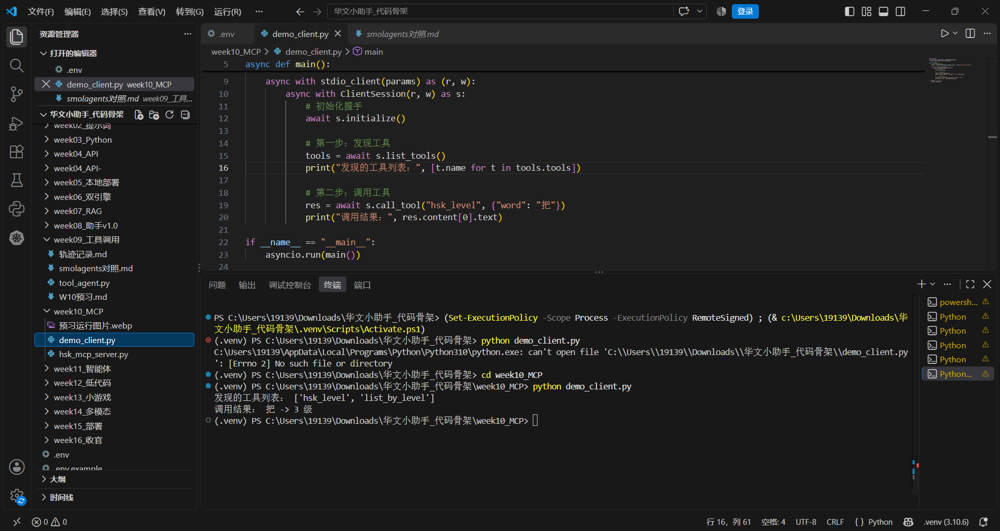
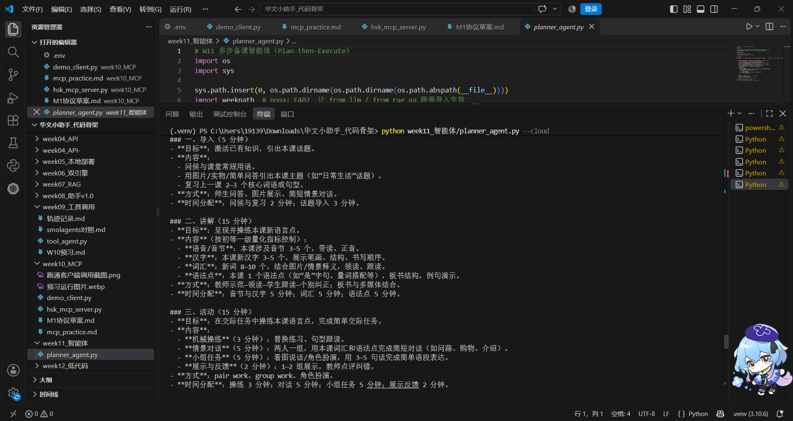

# W10 MCP 实验记录

## 一、配置记录
- **客户端环境**：使用讲义提供的最小客户端脚本 `demo_client.py`。
- **服务端配置**：服务端为 `hsk_mcp_server.py`，通过 `StdioServerParameters(command="python", args=["hsk_mcp_server.py"])` 启动。

## 二、调用证据
1. **工具列表**：运行 `python demo_client.py` 后，成功列出工具：`['hsk_level', 'list_by_level']`。
2. **调用结果**：成功调用 `hsk_level("把")`，返回结果：`把 -> 3 级`。

## 三、三者辨析
- **Function Calling**：模型侧机制，解决模型怎么「点名」要调哪个工具。
- **MCP**：工具侧协议，解决工具怎么被统一发现和调用。
- **普通 API 调用**：程序侧直连，代码直接请求服务，没有模型决策参与。

## 四、作业4：多步规划预习（选做加分）
成功运行了 `planner_agent.py --cloud`，可以看到《愚公移山》的备课任务被拆解成了 4 个有序步骤（导入、讲解、活动、产出），截图如下：
